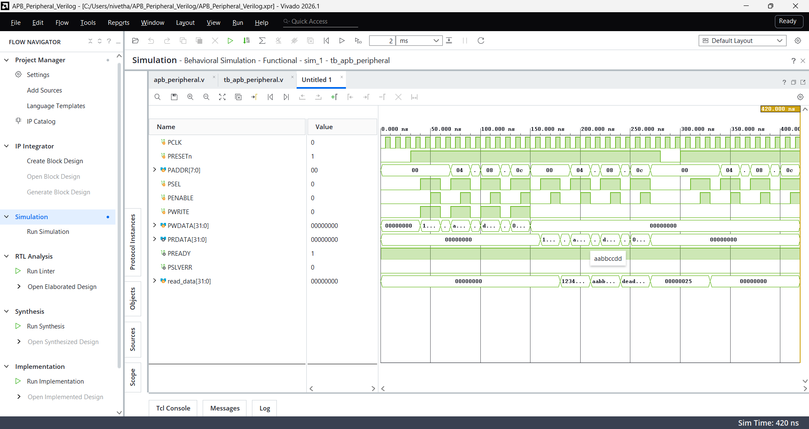

# APB Peripheral Verilog

## Overview
This project implements a 32-bit APB (Advanced Peripheral Bus) slave peripheral using Verilog HDL. It supports register read and write operations through a simple APB interface.

## Features
- APB setup and access phase support
- Four 32-bit memory-mapped registers
- Read and write operations
- Active-low asynchronous reset
- Immediate transfer completion using `PREADY`
- Error response signal `PSLVERR`
- Self-checking Verilog testbench

## Register Map

| Address | Register | Description |
|---|---|---|
| `0x00` | `REG0` | 32-bit data register |
| `0x04` | `REG1` | 32-bit data register |
| `0x08` | `REG2` | 32-bit data register |
| `0x0C` | `REG3` | 32-bit data register |

## Design Details
- **Data width:** 32 bits
- **Address width:** 8 bits
- **Clock:** `PCLK`
- **Reset:** Active-low `PRESETn`
- **Transfer completion:** `PREADY = 1`
- **Error response:** `PSLVERR = 0`

## Simulation and Verification

The design was simulated in Xilinx Vivado 2026.1 using a self-checking Verilog testbench.

The testbench verifies:
- Writes and reads for all four registers
- Correct data retention
- Reset functionality
- Expected register values after reset

**Simulation result:** `ALL APB TESTS PASSED!`

## Simulation Waveform

## Tools Used
- Verilog HDL
- Xilinx Vivado 2026.1
- Behavioral Simulation

## Author
Nivetha Mohanraj
